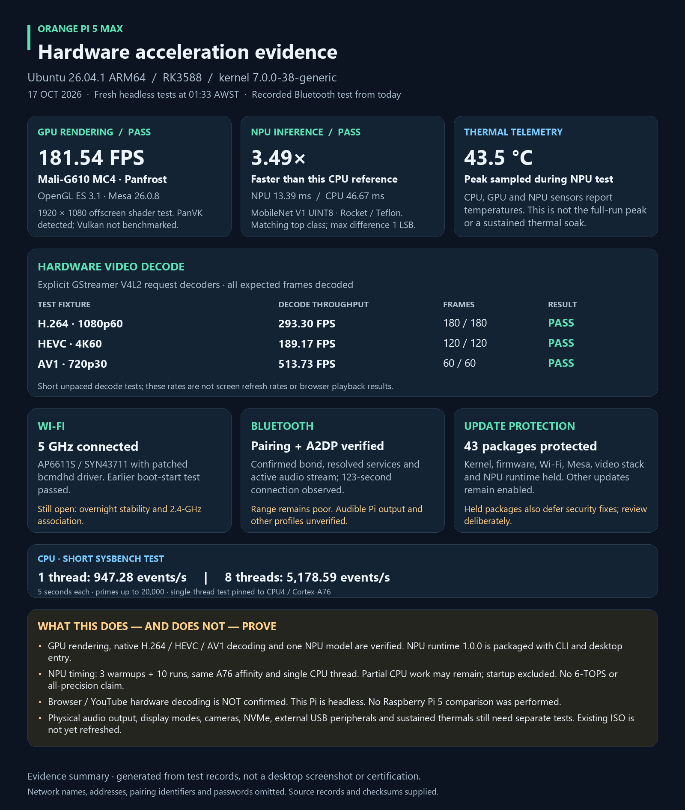

# Ubuntu 26.04.1 for Orange Pi 5 Max

Community integration for the **Orange Pi 5 Max / RK3588**, with verified GPU
rendering, native hardware video decoding, 5-GHz Wi-Fi, Bluetooth pairing/A2DP,
and packaged NPU inference on the development eMMC installation.

**Status: development preview, not a fully qualified all-hardware release.**
These results apply to the tested board and stack, not every peripheral, codec,
application or Orange Pi model. Not an official Canonical or Orange Pi product.

## Updated test evidence



Measured 17 October 2026. This graphic is a summary of real test records, not a
desktop screenshot. [Raw acceleration results](docs/acceleration-proof-20261017/live-acceleration.json)
and [complete hardware status](docs/mainline-hardware-support.md) are included.

| Feature | Verified result | Important limit |
|---|---|---|
| GPU | Mali-G610 MC4; Panthor/Panfrost; OpenGL ES 3.1; 181.54 FPS offscreen shader test | PanVK enumerates; no Vulkan game benchmark |
| Hardware video decode | H.264 1080p60: 293.30 FPS; HEVC 4K60: 189.17 FPS; AV1 720p30: 513.73 FPS; all fixture frames decoded | Short unpaced native GStreamer tests, not display refresh rates or YouTube tests |
| Wi-Fi | AP6611S/SYN43711; connected on 5 GHz; repaired boot ordering passed a reboot | Overnight recovery remains unresolved; 2.4-GHz association not tested |
| Bluetooth | Discovery, matching-code pairing, bonding, A2DP connection and active stream observed; 123-second connection | Practical range remains poor; audible Pi output and other profiles not qualified |
| NPU | Rocket/Teflon MobileNet V1 UINT8 inference; 13.39 ms versus 46.67 ms single-thread CPU reference (3.49×) | One model/sample; partial CPU work possible; not a 6-TOPS, all-core or all-precision claim |
| Update protection | 43 selected packages held; other Ubuntu updates remain enabled | Held packages also defer security fixes and require deliberate review |
| Ethernet / eMMC | Working on the development board | Not a qualification of arbitrary storage/peripherals |

There is **no matched Raspberry Pi 5 benchmark**. Browser/YouTube hardware decoding,
hardware encoding, physical audio output, display-mode changes, cameras, NVMe,
external USB devices and sustained thermal performance need separate testing.

## Downloads and installation status

**No current ISO is published yet.** The local October 13 export predates the
Bluetooth, NPU, desktop and update-protection work; it is deliberately not offered
as the current build. See [release status and gates](releases/README.md).

The planned custom `.iso` is a **container for a flashable eMMC image**, drivers
and documentation—not a bootable UEFI installer. Extract the inner `.img.gz`;
do not write the ISO directly to eMMC. Never flash a mounted running system or
assume an `mmcblk` device number. Keep a board-specific recovery SD and back up
the target before flashing. Full flashing instructions will accompany the image.

The original Ubuntu installer ISO, original Arch image, development credentials,
SSH keys, saved Wi-Fi profiles, Bluetooth bonds and personal logs are not included.

## Repository layout

| Section | Contents |
|---|---|
| [`drivers/`](drivers/README.md) | Wi-Fi source/patch, Bluetooth and board integration notes, GPU/video/NPU guidance |
| [`npu-package/`](npu-package/README.md) | Isolated NPU application, packaging code, tests and third-party notices |
| [`desktop-fixes/`](desktop-fixes/README.md) | Player/mode launchers, acceleration report, wallpaper registration, Wi-Fi boot-order service |
| [`scripts/`](scripts/README.md) | Benchmarks, board-tree utilities and selective update protection |
| [`docs/`](docs/mainline-hardware-support.md) | Hardware matrix, measurement data and known limitations |
| [`assets/wallpapers/`](assets/wallpapers/) | Three project wallpapers; third-party names/logos do not imply endorsement |
| [`releases/`](releases/README.md) | Binary release status and publication checklist |

## Everyday NPU use

On a matching installation with the runtime installed, run as an ordinary user:

```sh
orangepi-npu doctor
orangepi-npu demo
orangepi-npu classify '/path/to/photo.jpg'
orangepi-npu verify --runs 20
```

The **Orange Pi NPU** desktop entry provides the same local-image classification
workflow. Images stay on the device. This is not a chatbot or an arbitrary RKNN
model runner. See the [NPU runtime guide](npu-package/README.md).

## Updates

The tested stack is Ubuntu kernel `7.0.0-38-generic`, Mesa `26.0.8`, GStreamer
`1.28.2`, patched bcmdhd `101.10.591.52.27-6+opi5max1`, and NPU runtime `1.0.0`.
Do not transplant module binaries across kernel ABIs or use another board's DTB.

On the protected development installation:

```sh
orangepi-update-guard status
orangepi-update-guard review
```

Protection is selective, reversible, and **not a guarantee against every update
regression**. It does not cover Snap refreshes, forced installs or distribution
upgrades. [Policy, package list and undo instructions](docs/selective-update-protection.md).

## Licences and support

The root [MIT licence](LICENSE) applies to original project material unless a
file or subdirectory states otherwise. It does **not** relicense Linux, bcmdhd,
firmware, libraries, models or other third-party material. Preserve all upstream
notices. [Third-party licensing and binary-release requirements](THIRD_PARTY_NOTICES.md).

Use GitHub Issues with the exact board, kernel/runtime versions, symptoms and
redacted diagnostics. Never post passwords, private keys, Wi-Fi profiles or
personal Bluetooth identifiers. This experimental community project is provided
without warranty. Backups and recovery media are essential.
